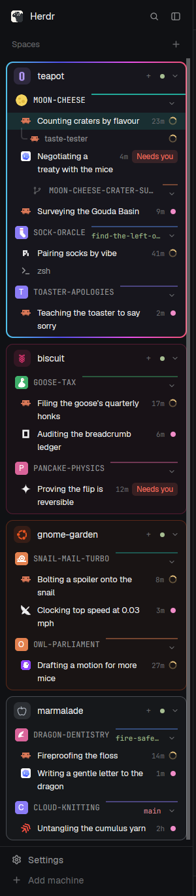

# Herdr Raster

One sidebar for the [Herdr](https://herdr.dev) desktop app with every machine, project
and agent you run: a card per machine, the projects on it as headings, and each agent
and terminal under its project with its state and how long it has been in it.



- **A card per machine**, with an icon and colour for what it is: Omarchy, macOS,
  Raspberry Pi, Windows (WSL), containers, FreeBSD and about twenty Linux
  distributions. The machine you're looking at gets a slowly moving rainbow edge.
  Drag a machine's header to put the cards in your order.
- **Projects, not just spaces.** A repo's own logo replaces the space's letter. Two
  spaces in one checkout share one heading; a worktree sits under its checkout. The
  branch shows when it isn't `main` or has work to push (green) or pull (red).
- **Agents where they work.** Each agent is listed under its project with its
  sub-agents, a spinner while it works, "Needs you" when it's waiting on you, and the
  time in its current state. Plain terminals follow, quieter.
- **Keys that follow the list.** Alt+↑/↓ walk it one agent or terminal at a time.
  Herdr's next/previous-agent keys go in the same order.

## Install

```sh
git clone https://github.com/temet-ai/herdr-raster.git
cp -r herdr-raster/mods/raster ~/.config/herdr-app/mods/
cp herdr-raster/layouts/main-raster.json ~/.config/herdr-app/layouts/
herdr-app check ~/.config/herdr-app/mods/raster
herdr-app do layout.switch '{"name":"main-raster"}'
```

Then add the `layout:main-raster` section of `keys.json` to
`~/.config/herdr-app/keys.json` for Alt+↑/↓. `ctrl-shift-l` switches back to any other
layout.

It needs `git`, and ImageMagick (`magick`) for project logos. Without ImageMagick,
spaces keep their letters.

### Your own layout

Point your layout's spaces block at the mod:

```json
{ "id": "spaces", "type": "block", "size": { "weight": 1 }, "min": 90, "content": { "mod": "raster" } }
```

To look for local clones somewhere other than `~/projects`, `~/code`, `~/src`, `~/dev`,
`~/Developer`, `~/git`, `~/repos`, `~/work` and `~/Documents/github.com`, add
`"props": { "cloneRoots": ["/srv/src", "code"] }` (relative paths are under home).

### Project logos

The first time a repo shows, Raster looks for `.herdr/icon.svg` or `.png`, then an icon
or logo in the usual places, then a favicon, and keeps a 64px copy in
`mods/raster/projects/<repo>.png`. Put your own PNG there to choose one.

## License

MIT (`LICENSE`). Raster started as a copy of the spaces mod that ships with Herdr; that
code keeps Herdr's Apache License 2.0 (`LICENSE-APACHE`). Machine icons are from
[Simple Icons](https://simpleicons.org) (CC0); the brands are their owners'.
