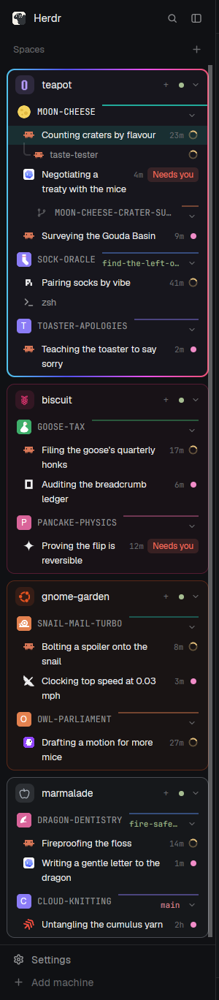

# Raster

Herdr's sidebar as one list of everything you run: a card per machine, the projects on it
as headings, and every agent and terminal under its project with its state and how long it
has been in it. The card of the machine you're looking at has a slowly moving rainbow edge.
Alt+↑/↓ walk the list one agent or terminal at a time.

## What you see

The mod fills the `spaces` block of the sidebar (268px wide in `main-raster`) on the
`chrome` background. Top to bottom:

- **Header**, 31px, 16px in from the left and 10px from the right: "Spaces" in 11.5px
  `dim`, and a 26px **+** (new space, 14px icon) on the right.
- **The list**, 8px side padding, 14px at the bottom, a scrollbar always shown.
- **Machine cards**, once any machine other than this computer is known (with one computer
  the list has no cards). 8px apart. Each card: radius 10, 4px padding, a 1px border in the
  machine's colour (alpha `50`, `c0` when the shown space is on it, `border` when the
  machine is away), filled with its colour at `0a` (`foreground` at `05` when away).
  - **Machine header**, 32px, radius 7: a 24px tile (radius 7, the machine's colour at
    `24`) holding its 14px icon, the name (12.5px medium, `foreground`, `muted` when away),
    a **+** (new space on that machine, only when connected), a 6px dot (`ansi2` connected,
    `dim` away) and a chevron (11px, down open, right folded). This computer shows under its
    host name.
  - **Away machines** say why after the name: the state ("unreachable", "asleep"). A
    machine that needs a login shows "needs a login: run" in `blocked` 11px under the
    header, then `hc machine login <name>` in `muted` and a **Copy** button (`raised`,
    "Copied" once pressed). A machine whose name now answers with a different core shows
    "rebuilt ·" and **Connect** ("Connecting…" while it works, the error in `blocked` if
    it fails), and nothing else in its card.
  - **A machine with no spaces** shows a 28px "New space there" row with a 12px **+**, in
    `dim`; "Loading…" while its layout loads.
  - **Machine kinds**, icon and colour: Omarchy (`accent`), Raspberry Pi `#d6336c`, macOS
    `#b4bcc6`, Windows (WSL) `#3b8eea`, container `#2496ed`, FreeBSD `#c0392b`, Ubuntu
    `#e95420`, Debian `#d70a53`, Fedora `#51a2da`, Arch Linux `#1793d1`, EndeavourOS
    `#7f7fff`, Manjaro `#35bf5c`, NixOS `#7eb6ff`, Alpine `#3a8fd6`, openSUSE `#73ba25`,
    Linux Mint `#87cf3e`, Gentoo `#9c8fd8`, Rocky Linux `#10b981`, AlmaLinux `#ff4649`,
    CentOS `#a14f8c`, Red Hat `#ee0000`, Kali `#557cf2`, any other Linux (Tux) `#e8b923`.
    Anything else is `muted`, with Herdr's `server` icon (another machine) or `monitor`
    icon (this computer). The header's tooltip says the kind, or the board model on a Pi.
  - **The shown space's card** has a rainbow edge in place of the border: 1.5px of a hue
    strip showing round an opaque inner card (radius 8.5, `chrome`, then the machine's
    colour at `0a`, 2.5px padding).
- **Project headings**, 28px tall, 5px above, 3px top padding, 8px side padding, radius 6:
  an 18px tile (the repo's logo, else the space's first letter, white bold 10.5px on the
  space's colour, radius 4); the name in capitals (monospace 11px semibold, at most 150px,
  `foreground` for the shown space, else `muted`), 7px after the tile; then, filling the
  rest of the row, a 1.5px line in the space's colour along the top. The shown space's line
  is full colour and runs on 10.5px past the row into the card's frame; the others are at
  alpha `73` and stop short. Under the line's right end, monospace 10px: the branch and the
  fold chevron.
  - The branch shows when it isn't `main`, `master` or the space's own name, or when there
    is work to push or pull. No counts; its colour is the state: `ansi2` ahead, `ansi1`
    behind, `dim` in step. A detached head shows `(detached)`.
  - The space's colour is one of six, `ansi6 ansi3 ansi4 ansi5 ansi2 ansi1`, drawn as
    `#22a99a #e3814f #5b8def #8b7cf6 #3fae6a #d9649a`; a new space gets the least used.
  - A worktree's space sits under its checkout's heading, its tile replaced by a 13px
    `dim` branch icon, 22px further in.
  - Several spaces in one checkout are one project: one heading, all their terminals under
    it.
- **Agent rows**, at least 24px, 3px vertical padding, 16px in, 9px gaps, 11.5px: the
  program's 14px icon; what the agent is doing (a tab name someone typed when it is the
  tab's one agent, else the agent's own title, else its program; its folder and " · "
  first when it works outside the space's folder), wrapping to more lines rather than
  truncating, `muted` when idle and not focused; then the time in its state (monospace
  10px `dim`) and its status mark, both aligned with the first line.
- **Tab-mates**: agents sharing a tab are joined by a bracket in the gutter at 5px, 2px
  in the space's color. It starts with a rounded corner at the tab's name (a 16px row,
  monospace 9.5px uppercase in the space's color at 85%, "TAB n" when nobody named it;
  clicking it renames the tab in place: Enter or clicking away keeps it, Escape drops it,
  an empty name gives the tab its number back),
  ticks in to 2px short of each agent's icon centre, runs plainly past sub-agent rows and
  ends in a rounded corner at the last agent. At 60% opacity, breathing between 50% and
  100% every 2.6s while any of them works.
- **Sub-agent rows** under their agent, 24px, 11px: tree lines (1.5px `input`, a rounded
  elbow at each), the 13px program icon, the name in `muted` (`foreground` and a `raised`
  fill while peeked), and a status mark.
- **Terminal rows** (shells, editors, servers) after the agents, 24px, 11.5px: the program
  icon and its title in `muted` (`foreground` when focused). When it works outside the
  space's folder, the folder leads and the title follows in 11px `dim`.
- **The focused agent or terminal** gets a flat tint of its space's colour (alpha `2b`),
  reaching 2.5px past the row on each side; as the card's last row it fills to the card's
  bottom with rounded bottom corners (8.5).
- **While the list has the keyboard**: a 2px `accent` right edge.

Narrower than 160px, the list becomes a rail: per machine its 13px icon (with a 6px dot,
`ansi2` or `dim`, for another machine), then one 32×26px cell per space with its number
(`foreground` on `selected` when shown, else `muted`) and, at the right, `●` when something
in it is done or needs you, else `·`, in that status's colour.

## How it behaves

- **Agent status marks:** working is a 12px `working` spinner, one turn every 0.9s;
  blocked is a "Needs you" pill (18px tall, 6px padding, radius 5, 10.5px semibold
  `blocked` on `blocked` at alpha `26`); done is a 7px `done` dot; idle is a 7px ring
  (1.5px, `idle`). Sub-agents never show done (their parent's done is the news); a
  sub-agent's error shows as blocked.
- **Time in state:** `<1m`, then minutes, hours, days (`14m`, `3h`, `2d`). The clock
  restarts when the state changes; done and idle count as one state. Kept across restarts.
- **Clicks:** a heading shows its space; an agent or terminal row focuses its pane; a
  sub-agent opens a peek of it. A project's chevron folds it: folded, it shows the count of
  its terminals and its most urgent state. A click on a machine's header folds the card.
  Right-click a heading for Herdr's space menu. **+** makes a new space (on that machine
  from a machine's header or its "New space there"). On the rail, a machine needing a
  login opens Herdr's machine settings.
- **Hover:** rows, headings, chevrons and buttons take `hover`; agent rows show the folder,
  program, machine and tab; terminal rows the folder and program.
- **Drag:** a heading onto another on the same machine moves the space (half transparent
  while dragged, a 2px `accent` line where it lands). A machine's header onto another card
  puts the machine above it (top half) or below it (bottom half), with a 2px `accent` line
  5px outside the card. The machine order is kept; until one is dragged it is this
  computer, connected machines, then the rest, each by name.
- **Keys:** `raster.next` / `raster.prev` move one stop down or up and wrap. Each agent and
  terminal under an open project is a stop; an empty or folded project is one stop; folded
  machines are skipped. Herdr's `agent.next` / `agent.prev` follow the list's agent order.
  `pane.go` onto the sidebar gives the list the keyboard; ↑/↓ walk it there, and Enter, →
  or Esc go back to the focused pane.
- **What moves:** the rainbow strip slides there and back every 16s, linear; spinners turn.
  Nothing else animates.
- **Git** is read when a space appears or changes folder, when a command or an agent's turn
  ends in that repo, when a machine's layout is back, when a local repo's git folder
  changes, and otherwise once a minute while the window is in front (not for folded
  machines). A new space waits up to 1.5s for its git before it shows, so a worktree
  appears under its checkout instead of jumping there.

## Built from

- `mods/raster/`: `main.js`, `mod.json` (`"focusable": true`, version 0.1.0,
  `cloned_from` Herdr's `spaces` 0.1.15), `icons/`. The agent rows follow Herdr's shipped
  `agents` mod.
- `layouts/main-raster.json`: Herdr's `main` with its `spaces` and `agents` blocks replaced
  by one `spaces` block (`weight: 1`, `min: 90`) holding `{"mod": "raster"}`.
- `keys.json`: `"layout:main-raster": { "alt-up": "raster.prev", "alt-down": "raster.next" }`.
- Layout props, all optional: `cloneRoots`, the folders searched for clones on this
  computer (default `projects code src dev Developer git repos work Documents/github.com`,
  relative to home); `kinds`, `{ "<machine>" | "local": "<kind>" | { kind, host } }`, sets
  a machine's kind (and this computer's shown name) instead of detecting it; `statusDir`,
  a folder of Claude Code status-line JSON (`<terminal>.json`, local terminals only,
  watched), whose `session_name` labels an agent whose title is only its program's name.
- Shipped mods: art from `workspace-chrome` (`plus`, `chevron-down`, `chevron-right`,
  `spinner`, `branch`, `server`, `monitor` SVGs); `menu` for the right-click popup
  (`openOverlay({mod: "menu", kind: "popup", width: 200, height: 260, props: {tab:
  "space", target: {id}}})`).
- `herdr` functions: `spaces machines panes agents terminals focused setAgentOrder run
  nextCommand openOverlay settings exec hc theme shared setShared watchFolder window layout
  appHome home props`. Commands run: `space.select space.move space.new pane.focus pane.go
  terminal.peek app.settings`. `hc machine ls --json` every 15s; `hc machine rm` and
  `hc machine add` for **Connect**.
- Shared values: `space.colors` (read and written), `fleet.live` (read, optional).
  `localStorage`: `machines.kinds`, `machines.order`, `machines.folded`,
  `machines.reconnecting`, `spaces.folded`, `changed`.
- Programs: `git rev-parse`, `symbolic-ref`, `rev-list` on the space's machine; one probe
  per machine (`uname -s -n -r`, `/proc/device-tree/model`, `/etc/os-release`'s `ID`,
  `/.dockerenv` or `/run/.containerenv`); one `find` on this computer for clones (depth 5,
  each one's `git remote get-url origin`); a `sh` loop over candidate logo paths, `mkdir`,
  `test` and `magick` (ImageMagick) to make a 64px PNG.
- Art: `icons/rainbow.png` (the hue strip, drawn 1200×1400), `icons/corner-{tl,tr,bl,br}.svg`
  (10px corner masks), machine icons (Simple Icons, CC0, apart from
  `omarchy.svg`, Omarchy's mark, and `windows.svg`, drawn here).

## Watch out

- **Layout props** come from `props()`; `init`'s first argument doesn't carry them.
- **The rainbow edge:** GPUI clips square, so the strip shows at the card's corners. Paint
  the four 10px corner masks in `chrome` over them. The strip is an `image` at `left: -600`,
  1200px wide, moved with `.loop("left", {from: -600, to: 0, period: 16000, easing:
  "linear"})`: native, no timer, and it stops when not drawn.
- **The focused row's tint** is an absolute layer behind the row's content, added before
  its children. A negative bottom margin instead collapses the card.
- **Machine kinds:** the probe's lines map to a kind in this order: `Darwin` is macOS, a
  model matching "raspberry pi" is a Pi, a kernel release containing "microsoft" is WSL, a
  container file is a container, `FreeBSD`, then the os-release `ID` (`raspbian` is a Pi,
  `opensuse-tumbleweed` and `opensuse-leap` are openSUSE), then any `Linux`. Results are
  kept in `localStorage` with the machine's core id, so a machine rebuilt under the same
  name is asked again.
- **Project logos** are looked for once per run per repo: `.herdr/icon.{svg,png}`,
  `icon`/`logo` in the root and `assets/`, `*logo*` in `docs/assets/`, `.github/` (also
  `*icon*.png`) and `docs/`, then `favicon` in the root, `static/`, `public/`,
  `frontend/static/`, `frontend/public/`, `web/public/`, and `app/icon.png`. They're kept
  in `mods/raster/projects/<repo>.png` under Herdr's home; a PNG put there by hand wins.
  SVGs are rasterised at density 384. A space on another machine uses the logo of the
  clone of the same repo on this computer, matched by folder name, then by `origin`'s repo
  name. Worktrees don't look for their own.
- **The clone search** skips any path containing `/.claude/` and times out after 30s.
- **Space order** is written back to Herdr with `space.move` so the list, Herdr's own order
  and `agent.next` agree. A move can lose a sync race with another machine: wait 1s and for
  the moved machines' layouts to be ready before trying again.
- **Git reads** use refs only (`rev-parse`, `symbolic-ref`, `rev-list`), never `status`,
  so they don't scan the working tree. Only git's own "not a git repository" is remembered
  as no repo; any other failure is asked again.
- **Optional:** if another mod shares `fleet.live` as `{ [any]: { seats: { [terminal
  address]: { needs: true } } } }`, those agent rows say "NEEDS YOU" (monospace 10px
  `blocked`) in place of their time. Without it nothing shows.

## Done when

- `herdr-app check mods/raster` passes and `layout.switch {"name": "main-raster"}` shows
  the list with no `*.error` file.
- With another machine added, each machine is a card with its own icon and colour, and the
  shown space's card has the moving rainbow edge.
- A repo with a logo shows the logo on its heading; one without shows its letter.
- An agent's row goes from spinner to "Needs you" to dot as it works, asks and finishes,
  and its time restarts at each change.
- Alt+↓ from the first row visits each agent and terminal in list order and wraps.
- Dragging a machine's header onto the bottom half of another card moves it below that
  card, and the order survives a restart.
- Narrowed under 160px, the sidebar shows numbered cells.
